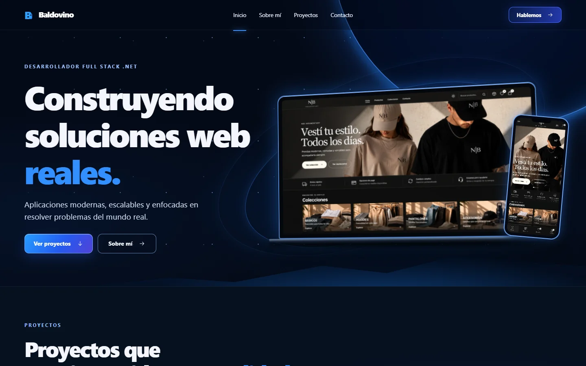

# Portfolio

Hola, soy **Brian Baldovino**, desarrollador Full Stack .NET, enfocado en crear aplicaciones web modernas, funcionales y orientadas a resolver problemas reales.

El sitio presenta proyectos seleccionados, experiencia técnica y casos de estudio con foco tanto en desarrollo como en experiencia de usuario.



## Portfolio online

**Ver portfolio:**
https://baldovinob93.github.io/Baldovino-Portfolio/

## Proyecto destacado

### N|B Indumentary

E-commerce de indumentaria desarrollado como una experiencia completa de compra y gestión.

Incluye:

* catálogo y variantes de productos
* carrito y checkout
* integración con Mercado Pago
* seguimiento de pedidos
* administración de productos, stock y ventas
* experiencia responsive para desktop y mobile

El portfolio incluye un case study completo del proyecto, desde la experiencia de compra hasta la administración.

## Tecnologías

* HTML
* CSS
* JavaScript
* Node.js
* GitHub Actions
* GitHub Pages

### Proyecto N|B

* ASP.NET Core MVC
* Razor
* Entity Framework Core
* SQL Server
* Bootstrap
* JavaScript
* Mercado Pago

## Desarrollo local

Requiere **Node.js 20 o superior**.

```bash
node scripts/dev.mjs
```

Abrir:

```text
http://127.0.0.1:4173/
```

Para generar y verificar el build:

```bash
node scripts/build.mjs
node scripts/check.mjs
```

## Estructura principal

```text
src/        Código y contenido del portfolio
public/     Assets e imágenes públicas
scripts/    Build, desarrollo y validaciones
docs/       Recursos para documentación
.github/    Workflow de GitHub Pages
```

## Contacto

**GitHub**
https://github.com/baldovinob93

**LinkedIn**
https://www.linkedin.com/in/brian-baldovino-791b993b9

**Email**
[baldovinob93@gmail.com](mailto:baldovinob93@gmail.com)

---

Diseñado y desarrollado por **Brian Baldovino**.
